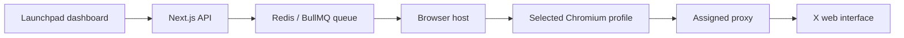

# Twitter Bot for Posting — No X API Key Required

**twitter-bot-for-posting** is a browser-based Twitter/X posting dashboard built with Next.js, TypeScript and Playwright. Connect your own X accounts, write a post, and publish to one account or all connected accounts through isolated Chromium profiles with assigned proxies.

**No Twitter/X API key, developer account, bearer token or paid X API subscription is required.** Posts are submitted through X’s web interface using an authenticated browser session. You still need an X account, a valid session and internet access; proxy service charges may apply.

The dashboard is called **Launchpad** and runs locally at **http://localhost:3000**.

## Features

- A shared text composer with a dynamic account selector.
- **All connected accounts**: queue the same text once per distinct connected username.
- Five persistent Chromium profiles with separate processes, cookies and proxy assignments.
- Import x.com cookies exported as EditThisCookie JSON.
- Display account connection status, browser status, proxy endpoint and measured public IP.
- Encrypted cookie backups, periodic checkpoints and session recovery across restarts.
- Bounded recovery for X application-loading errors before post submission.
- Per-account publication links and actionable errors.
- One-command startup and graceful shutdown.

## How posting works



Each selected account uses its own browser profile and proxy. Posting operations run sequentially through the queue. A failure on one account does not cancel the other queued accounts.

The browser checks the signed-in username before entering the text. A confirmed publication produces a link to the post. An uncertain submission is not automatically retried, helping prevent duplicate posts.

## Tech stack

| Component | Technology |
| --- | --- |
| Dashboard and backend | Next.js 15, React 19, TypeScript |
| Styling | Tailwind CSS and custom CSS |
| Browser automation | Playwright 1.56 and Chromium |
| Background display | Xvfb |
| Database | PostgreSQL 16 and Prisma 6 |
| Command queue | Redis 7 and BullMQ |
| Validation | Zod |
| Deployment | Docker Compose |
| Testing | Vitest and Playwright browser checks |

## Quick start

The command wrappers are designed for macOS. Other operating systems may require adapting the startup scripts.

### Requirements

- Node.js 22 and npm.
- Python 3, used for the bounded Docker readiness check.
- Docker with Docker Compose, through Docker Desktop or Colima.
- Your own Twitter/X accounts and valid cookie exports.
- Provider credentials if using the included Oxylabs proxy setup.

### 1. Clone and install

Replace `YOUR_USERNAME` with the repository owner’s GitHub username:

```bash
git clone https://github.com/YOUR_USERNAME/twitter-bot-for-posting.git
cd twitter-bot-for-posting
npm ci
```

### 2. Configure the environment

For a fresh clone:

```bash
cp .env.example .env
```

Set these values in `.env`:

| Variable | Purpose |
| --- | --- |
| `DATABASE_URL` | PostgreSQL connection for host-side scripts; the template matches the local Docker database |
| `REDIS_URL` | Redis connection for host-side scripts; the template matches the local Docker queue |
| `APP_ENCRYPTION_KEY` | A stable 64-character hexadecimal key for session and secret encryption |
| `DASHBOARD_PASSWORD` | Any non-empty password for the local dashboard |
| `OXYLABS_USERNAME` | Proxy provider username when using the included proxy seed script |
| `OXYLABS_PASSWORD` | Proxy provider password when using that script |

Generate the encryption key locally:

```bash
node -e "console.log(require('node:crypto').randomBytes(32).toString('hex'))"
```

Copy the generated value into `.env` and keep it unchanged while retaining existing encrypted session data. Never commit `.env` or cookie exports.

### 3. Start the project

```bash
./run.command --build
```

This builds and starts the dashboard, PostgreSQL, Redis and browser service. Startup validates configuration and waits for browser readiness. Open **http://localhost:3000** and sign in with your dashboard password.

For subsequent starts:

```bash
./run.command
```

To stop:

```bash
./stop.command
```

Stopping preserves database data and persistent browser profiles. Use `--build` after changing application code.

### 4. Configure proxies

A fresh database creates five browser profiles in direct-connection mode. If you want the included Oxylabs configuration, set the provider credentials in `.env`, start the project, and run:

```bash
node --import tsx scripts/seed-profiles.ts
```

This assigns `dc.oxylabs.io` ports `8001`–`8005` to Browser 1–5. Confirm those endpoints are supported by your provider plan. Stop and restart the project after changing assignments so each browser uses its configured proxy.

The dashboard measures the outbound IP; an assigned endpoint alone is not proof of a unique or permanently fixed public IP. Proxy-mode browsers do not automatically fall back to your host IP.

## Connect X accounts

1. Sign in to your own X account in a regular browser.
2. Export its **x.com cookies** using EditThisCookie or a compatible JSON exporter.
3. Choose **Connect X account** on the appropriate Launchpad browser card.
4. Paste the JSON into the dashboard and connect.
5. Confirm that the expected username appears after the session check.

For multiple accounts, use separate regular Chrome profiles and keep each original session signed in. Imported cookies reuse the original X-issued session; logging out or revoking that session can invalidate its imported copy too. The current dashboard uses cookie import rather than interactive login inside the virtual browser.

Cookie exports are credentials. Paste them only into the local dashboard. The importer validates supported domains, expiry and required authentication cookies, then encrypts the queued import payload.

## Publish a post

1. Write your text in the shared composer.
2. Select one account or **All connected accounts**.
3. Review the selected accounts and click **Post**.
4. Follow each account’s result and publication link.

The composer supports plain text with a 280 Unicode-code-point limit. X’s own character-count rules may differ for URLs and some characters. Media uploads and scheduled posting are not currently implemented.

If a batch partly succeeds, select only the failed account before retrying the same text; choosing all accounts again can publish again to accounts that already succeeded.

## Browser isolation and persistence

The current configuration runs normal Chromium with `headless: false` on a private **Xvfb virtual display** inside Docker. Windows do not appear on the Mac desktop. This is background browser automation, not Chromium’s true headless mode and not a separate VM for every browser.

The five browser profiles share the virtual display but have independent processes and profile directories. Native profile cookies take priority over encrypted recovery snapshots. Live authentication cookies are checkpointed every minute and saved after successful checks/posts and before orderly shutdown. An empty authentication state does not overwrite the backup.

| Storage | Contents |
| --- | --- |
| Docker `postgres` volume | Browser/account metadata, proxy settings, encrypted secrets, cookie backups and latest posting results |
| Docker `browser-host-data` volume | Chromium profiles under `/app/data/browser-profiles/browser-1` through `browser-5` |
| Docker `redis` volume | Queued operations and temporary coordination state |

Cookie snapshots and proxy passwords use AES-256-GCM encryption. Chromium profile directories are not encrypted by the application’s encryption key. Profile data, screenshots, logs and `.env` are excluded from Git.

## Project structure

```text
apps/web/                      Next.js dashboard and API
apps/worker/                   Optional legacy automation worker
packages/browser/              Profiles, cookies, connection recovery and posting
packages/database/             Prisma client and database schema
packages/shared/               Configuration, encryption and queue utilities
scripts/profile-host.ts        Active browser queue worker
scripts/project-control.sh     Startup and shutdown orchestration
tests/                         Unit and browser integration checks
docker-compose.yml             Service definitions and persistent volumes
run.command                    Start the complete project
stop.command                   Stop without deleting profiles
```

The default stack uses `profile-host.ts`. The older worker is excluded unless the optional `automation` Compose profile is explicitly enabled.

## Testing

```bash
npm run typecheck
npm run lint
npm test
```

With the dashboard running and `.env` configured:

```bash
npx tsx tests/x-post-browser.ts
npx tsx tests/cookie-dashboard.ts
npx tsx tests/all-post-dashboard.ts
```

The posting browser fixture uses simulated pages; dashboard posting checks intercept requests. These checks do not publish real posts. The separate legacy `test:x` command can perform real X actions and is not part of this safe verification sequence.

## Troubleshooting

| Symptom | Action |
| --- | --- |
| Docker readiness timeout | Start or recover Docker Desktop/Colima, then rerun `./run.command` |
| Configuration validation error | Correct the named setting in `.env` |
| X application-loading error | Use **Recheck connection**; the pre-post check also attempts one cache reset/reload |
| X login or verification screen | Complete the required verification and import a valid session |
| Proxy or public IP check fails | Verify credentials, endpoint availability and provider connectivity |
| Publication result is uncertain | Check the X account before retrying to avoid duplicates |
| Storage errors | Free disk space; preserve profile and database volumes |

The current release is configured for **five browsers**. Managing 10–30 accounts requires dynamic profile management, resource controls and further load testing.

## Frequently asked questions

### Can I post to Twitter/X without an API key?

Yes. This project automates the X web interface through Playwright. It does not call the official X API as its posting integration and does not require X API credentials. X’s website naturally makes its own network requests, and Launchpad has its own local backend API.

### Does this create permanent independent sessions from imported cookies?

No. A copied session token remains controlled by X. Saved files survive restarts, but X can invalidate the session before its cookie expiry date.

### Can I post to multiple X accounts at once?

One click can queue a post to all connected accounts. The worker processes the accounts sequentially, with separate results and one target per distinct username.

### Is a different proxy the same as a separate computer?

No. A proxy changes network routing and egress IP. A separate browser profile isolates local browser state. Neither guarantees that X will accept a login or treat the account as a separate physical device.

Use this project with accounts you own or are authorized to manage. X authentication, verification, rate limits and proxy availability still apply.
